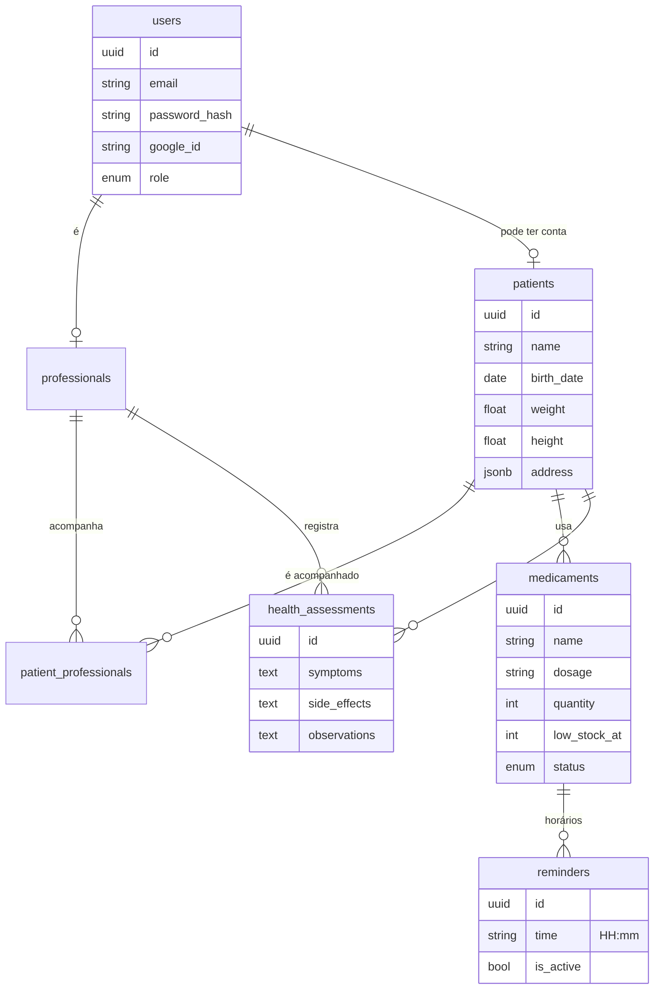

<div align="center">

# HealthMate API

**API REST da plataforma HealthMate: pacientes, medicamentos, lembretes e avaliações de saúde**


</div>

---

## Sobre

O **HealthMate** ajuda **profissionais de saúde autônomos** a acompanhar o tratamento dos seus
pacientes: quais medicamentos cada um toma, em que horários, quanto ainda resta em estoque e
como o paciente tem reagido.

Este repositório é a **API**. Ela cuida da autenticação, das regras de negócio e do acesso ao
banco. O front-end está em **[healthmate](https://github.com/megusta01/healthmate)**.

## Destaques

- **Isolamento por profissional:** cada profissional acessa apenas os próprios pacientes. O acesso a dados de outro profissional responde `404`, sem revelar que o registro existe.
- **Autenticação completa:** cadastro, login com e-mail/senha ou Google, access token curto, refresh token com rotação e detecção de reuso, logout que revoga a sessão.
- **Operações atômicas:** paciente e medicamentos (com seus lembretes) são criados numa única transação.
- **Dashboard pronto:** totais, agenda do dia, medicamentos com estoque baixo e avaliações recentes numa só chamada.
- **Documentação interativa:** Swagger em `/api/docs`.
- **Testada:** testes unitários e ponta a ponta (Jest + Supertest) contra PostgreSQL real.

## Tecnologias

| Categoria | Tecnologias |
|---|---|
| **Framework** | [NestJS 11](https://nestjs.com/), [TypeScript](https://www.typescriptlang.org/) (strict) |
| **Banco de dados** | [PostgreSQL](https://www.postgresql.org/) no [Supabase](https://supabase.com/), [Prisma 7](https://www.prisma.io/) com driver `pg` |
| **Autenticação** | JWT (`@nestjs/jwt`), bcrypt, cookies httpOnly, [Google Identity](https://developers.google.com/identity) |
| **Validação** | class-validator, class-transformer, validação das variáveis de ambiente |
| **Segurança** | Helmet, CORS restrito, rate limit (`@nestjs/throttler`), Row Level Security |
| **Documentação** | Swagger (`@nestjs/swagger`) |
| **Testes** | Jest, Supertest |
| **Hospedagem** | [Render](https://render.com/) (API) e [Supabase](https://supabase.com/) (banco) |

## Modelo de dados



Todas as tabelas usam UUID, datas com fuso horário, chaves estrangeiras com `ON DELETE CASCADE`
e **Row Level Security ligado**, para que a Data API pública do Supabase não exponha dados.

## Endpoints

Todas as rotas ficam sob `/api` e exigem autenticação, exceto as marcadas como públicas.

| Método | Rota | Descrição |
|---|---|---|
| `POST` | `/auth/register` 🌐 | Cadastra um profissional e inicia a sessão |
| `POST` | `/auth/login` 🌐 | Login com e-mail e senha |
| `POST` | `/auth/google` 🌐 | Login/cadastro com Google |
| `POST` | `/auth/refresh` 🌐 | Renova a sessão |
| `POST` | `/auth/logout` 🌐 | Encerra a sessão |
| `GET` | `/auth/me` | Usuário autenticado |
| `GET` `PATCH` | `/users/me` | Ver/editar perfil |
| `PATCH` | `/users/me/password` | Trocar ou definir senha |
| `GET` `POST` | `/patients` | Listar (busca e paginação) / cadastrar |
| `GET` `PATCH` `DELETE` | `/patients/:id` | Ficha completa / editar / excluir |
| `GET` `POST` | `/patients/:id/medicaments` | Medicamentos do paciente |
| `PATCH` `DELETE` | `/medicaments/:id` | Editar / excluir medicamento |
| `GET` | `/reminders/today` | Agenda do dia |
| `PATCH` `DELETE` | `/reminders/:id` | Pausar, reativar ou excluir lembrete |
| `GET` | `/assessments` | Relatórios (filtro por paciente e busca) |
| `POST` | `/patients/:id/assessments` | Registrar avaliação |
| `DELETE` | `/assessments/:id` | Excluir avaliação |
| `GET` | `/dashboard` | Resumo da tela inicial |
| `GET` | `/health` 🌐 | Healthcheck (testa a conexão com o banco) |

🌐 = rota pública. A documentação completa, com exemplos de payload, fica no Swagger: `http://localhost:3333/api/docs`.

## Como rodar

**Pré-requisitos:** Node.js **20.19+** (recomendado 24 LTS) e um projeto no [Supabase](https://supabase.com/) (plano gratuito).

### 1. Banco de dados

No painel do Supabase, clique em **Connect → ORM → Prisma** e copie a URL do
**session-mode pooler** (`DIRECT_URL`, porta **5432**).

### 2. Configuração

```bash
git clone https://github.com/megusta01/healthmate-api.git
cd healthmate-api
cp .env.example .env     # no Windows: copy .env.example .env
```

No `.env`, use a URL do session pooler em `DATABASE_URL` **e** em `DIRECT_URL`, e gere os segredos JWT com:

```bash
node -e "console.log(require('crypto').randomBytes(48).toString('hex'))"
```

### 3. Execução

```bash
npm install          # instala e gera o Prisma Client
npm run db:deploy    # cria as tabelas
npm run db:seed      # (opcional) dados de demonstração
npm run dev          # http://localhost:3333/api
```

O seed cria a conta `demo@healthmate.app` / `Demo12345`. Não rode o seed num ambiente público,
porque qualquer pessoa poderia entrar com essa conta.

### Variáveis de ambiente

| Variável | Obrigatória | Descrição |
|---|:---:|---|
| `DATABASE_URL` | ✅ | Conexão usada pela API (session pooler, porta 5432) |
| `DIRECT_URL` | ✅ | Conexão usada pelas migrations e pelo seed |
| `JWT_ACCESS_SECRET` | ✅ | Segredo do access token (32+ caracteres) |
| `JWT_REFRESH_SECRET` | ✅ | Segredo do refresh token (diferente do anterior) |
| `JWT_ACCESS_TTL` / `JWT_REFRESH_TTL` | | Validade dos tokens. Padrão `15m` / `7d` |
| `FRONTEND_URL` | | Origens liberadas no CORS (separadas por vírgula) |
| `COOKIE_SAMESITE` | | `lax` (padrão) ou `none` se front e API estiverem em domínios diferentes sem proxy |
| `GOOGLE_CLIENT_ID` | | Habilita o login com Google |
| `DATABASE_SSL` | | `true` para forçar SSL na conexão com o banco |
| `PORT` / `NODE_ENV` | | Padrão `3333` / `development` |

A aplicação não inicia se alguma variável obrigatória estiver ausente ou inválida.

## Scripts

| Script | O que faz |
|---|---|
| `npm run dev` | API com hot reload |
| `npm run build` / `npm run start:prod` | Build e execução de produção |
| `npm run db:migrate` | Gera uma nova migration a partir do `schema.prisma` |
| `npm run db:deploy` | Aplica as migrations pendentes |
| `npm run db:seed` | Dados de demonstração |
| `npm run db:studio` | Abre o Prisma Studio |
| `npm test` | Testes unitários |
| `npm run test:e2e` | Testes ponta a ponta (use um banco de teste) |
| `npm run lint` / `npm run typecheck` | Qualidade de código |

## Estrutura

```
src/
├── common/          # guards (auth global e papéis), decorators, paginação, filtro de erros do Prisma
├── config/          # validação das variáveis de ambiente
├── modules/
│   ├── auth/        # cadastro, login, Google, refresh, logout, cookies
│   ├── users/       # perfil e senha
│   ├── patients/    # pacientes e regra de acesso por profissional
│   ├── medicaments/ # medicamentos e lembretes
│   ├── assessments/ # avaliações de saúde
│   └── dashboard/   # resumo da tela inicial
├── prisma/          # PrismaService (adapter pg)
└── main.ts          # bootstrap: prefixo /api, helmet, CORS, validação, Swagger
prisma/
├── schema.prisma
├── migrations/
└── seed.ts
```

## Segurança

- **Protegido por padrão:** um guard global exige autenticação em toda rota nova, e só as marcadas com `@Public()` ficam abertas.
- **Tokens:** ficam em cookies `httpOnly` (inacessíveis ao JavaScript). O refresh token é guardado no banco apenas como hash.
- **Sessão:** a reutilização de um refresh token antigo derruba a sessão.
- **Senhas:** bcrypt com custo 12. A mesma mensagem de erro para e-mail inexistente e senha errada evita a descoberta de contas.
- **Rate limit:** 100 requisições/min por IP, e 10/min nas rotas de login e cadastro.
- **Validação:** `whitelist` + `forbidNonWhitelisted` rejeitam campos inesperados.

## Deploy (Render)

| Campo | Valor |
|---|---|
| **Build Command** | `npm ci --include=dev && npm run build` |
| **Start Command** | `npm run db:deploy && npm run start:prod` |
| **Variáveis** | as da tabela acima, mais `NODE_ENV=production` e `NODE_VERSION=24` |

Escolha a mesma região do banco no Supabase. Em produção o Swagger fica desativado e os cookies passam a ser `Secure`.

## Desenvolvedor

<table>
  <tr>
    <td align="center">
      <a href="https://github.com/megusta01">
        <br />
        <b>Gustavo Figueredo</b>
      </a><br />
      Desenvolvedor Full Stack<br />
      <a href="mailto:gustavofigueredo86@gmail.com">E-mail</a> ·
      <a href="https://github.com/megusta01">GitHub</a>
    </td>
  </tr>
</table>
